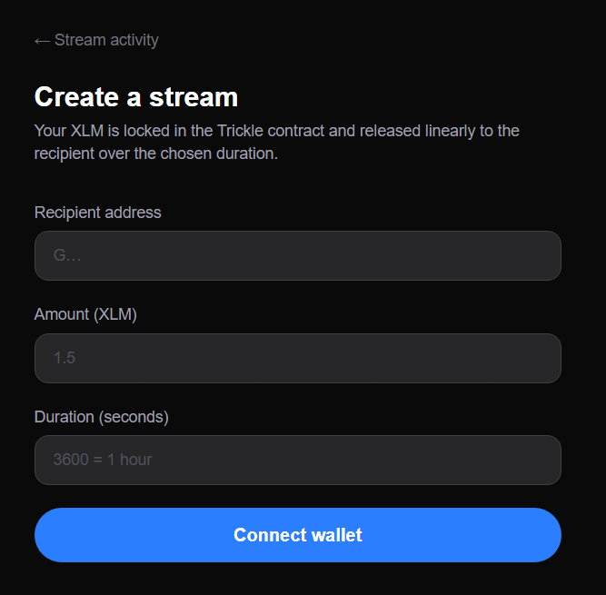
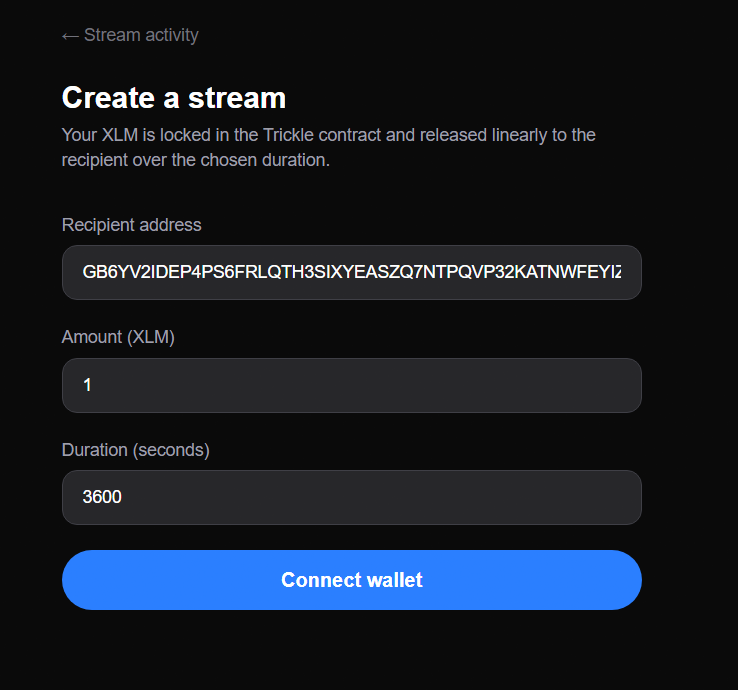
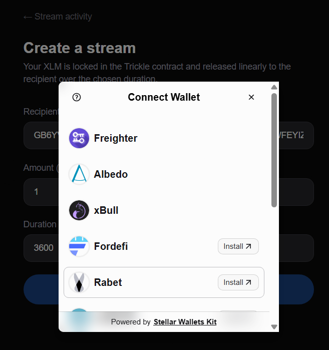
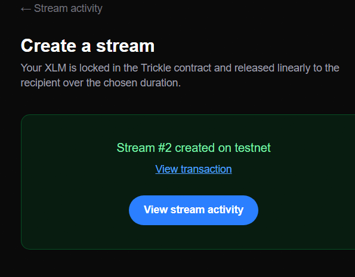
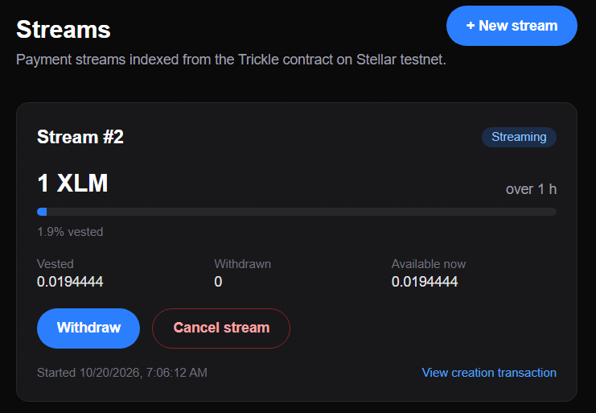
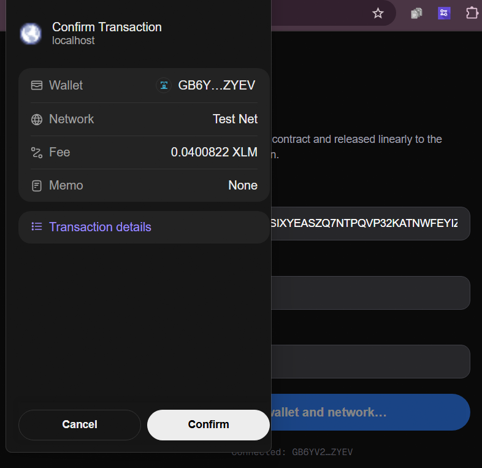
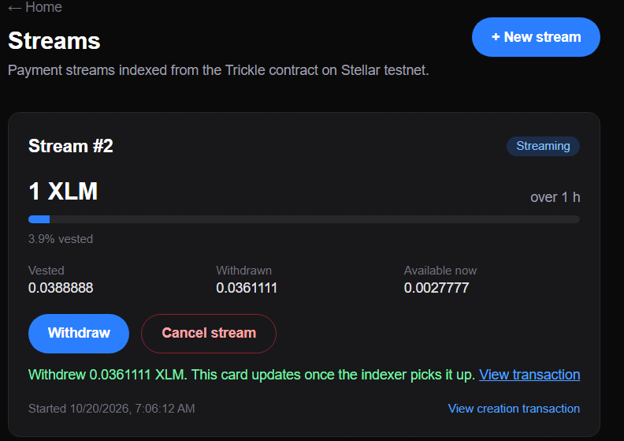
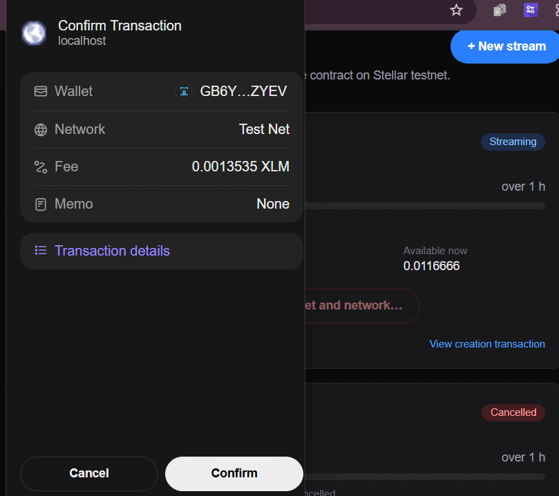
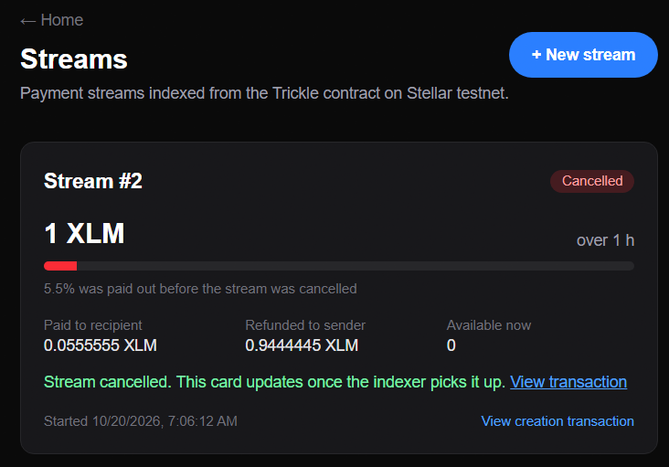

# Walkthrough

A full stream lifecycle on Stellar testnet: connect, create, withdraw, cancel.

## 1. Connect a wallet

## 2. Create a stream
Pick a recipient, an amount in XLM and a duration in seconds.

The wallet asks for approval. Nothing is sent until you confirm.

## 3. Watch it vest
The dashboard shows vesting progress, and the amount available to withdraw grows every second.

## 4. Withdraw
The recipient claims whatever has vested so far.

## 5. Cancel
The sender can cancel at any time. The recipient keeps what has vested, and the sender is refunded the rest.

## The transactions from this run
- [create_stream](https://stellar.expert/explorer/testnet/tx/de875169007aaf2ef6c9658d40a1028b8abb3936a8a85580139608e52afb7172)
- [withdraw](https://stellar.expert/explorer/testnet/tx/20a3c054ff0ea38cd1f1b46106ea4b2d840bd7a3b935aff52ef3ccd69bc031d3)
- [cancel](https://stellar.expert/explorer/testnet/tx/349c982c38cf8e83f0b339b3975d81a8463b2bffdb946ebb14003e4c3b3898e0)
